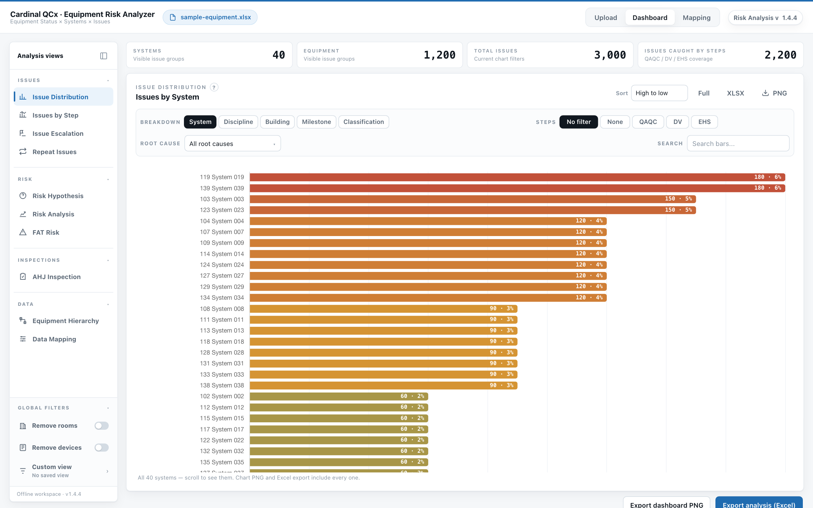

# Risk Analysis

A single-file browser app for analyzing commissioning (Cx) equipment workbooks. You drop in an Excel export, and it shows where issues are concentrated and whether the QAQC, DV, and EHS steps are actually catching them. Everything runs locally in the browser, and the workbook is never uploaded.

The question behind it: does equipment with more step coverage end up with more issues found early, or are some systems getting checked on paper while problems slip through? The export already has the data to answer that, split across separate tabs for equipment, systems, and issues.



## What it does

- Matches the workbook tabs and header rows automatically. A Mapping tab lets you override sheet and column picks, reassign step columns to categories, and see issue rows whose Equipment ID doesn't match any equipment.
- Scores each piece of equipment 0 to 3 by how many step categories (QAQC, DV, EHS) have entries, then compares average issues per score tier to test the coverage question above.
- Ranks risk by System, Discipline, Building, Milestone, or Classification with two models: blind spots (low step coverage and few issues found, weighted by equipment count) and hotspots (where issues are concentrated). Auto mode switches to hotspots when higher-coverage equipment shows fewer issues, since then the steps aren't a reliable early warning.
- Adds views for issues by system and Cx step, issue category escalations, repeat issues (same equipment and root cause), FAT risk, AHJ inspection status, and a System > Equipment hierarchy.
- Supports filters, saved custom views, drill-down from charts to the underlying equipment, PNG export of the dashboard, and Excel/CSV exports of rollups and hierarchy rows.
- Parses the workbook in a Web Worker and virtualizes the hierarchy table, so large exports stay responsive.

## Workbook format

Required tabs (matched by name, or picked on the Mapping tab):

- `Equipment Status Report`: needs `Equipment Name`, `Equipment Description`, `Building`, `UPN`, `Discipline`, and `Milestone`. Columns after `Discipline` whose headers contain `QAQC`, `DV`, or `EHS` count as step columns, and a non-empty cell marks that step as done.
- `Drop Downs- VF`: a `System Name` column whose values start with the three-digit UPN, like `100 Chilled Water`.
- `Issue Grid Report`: one row per issue with `Equipment ID`, and optionally `Issue ID`, `Cx Step`, `Category`, `Root Cause`, and `UPN`.

Optional tabs:

- `Full Export`: maps Equipment ID to Equipment Classification
- `Issue SQL Table`: original versus current issue category, used for the escalation view

## Stack

Plain HTML, CSS, and JavaScript in one `index.html`, with SheetJS (`xlsx-js-style`) for reading and writing Excel, Chart.js for charts, and html2canvas for PNG export. The libraries are vendored in `vendor/`, so it works offline.

## Run locally

```bash
npm install
npm run serve
```

Open `http://127.0.0.1:4179` and drop in `sample/sample-equipment.xlsx` to try it. The sample is synthetic: 1,200 pieces of equipment across 40 systems ("System 000" and so on) with 3,000 issues, one of which points at an Equipment ID that doesn't exist, so the Mapping tab has something to show.

To build the standalone file that gets attached to releases (all scripts inlined):

```bash
npm run build:standalone   # writes dist/Risk-Analysis-v<version>.html
```

The app makes one network call: on startup it checks the latest GitHub release and offers the new HTML file if there is one.

## Tests

```bash
npm test
```

The tests use `node:test`. They load the data pipeline straight out of `index.html` into a VM context and check the parsing, scoring, filtering, and chart row logic. `tests/sample-workbook.test.mjs` reads the sample workbook with the vendored SheetJS build and runs it through the same parse and model steps the app uses.
